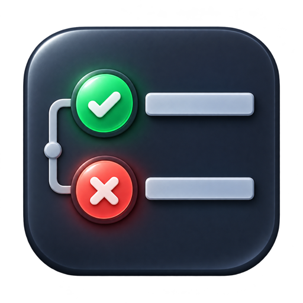
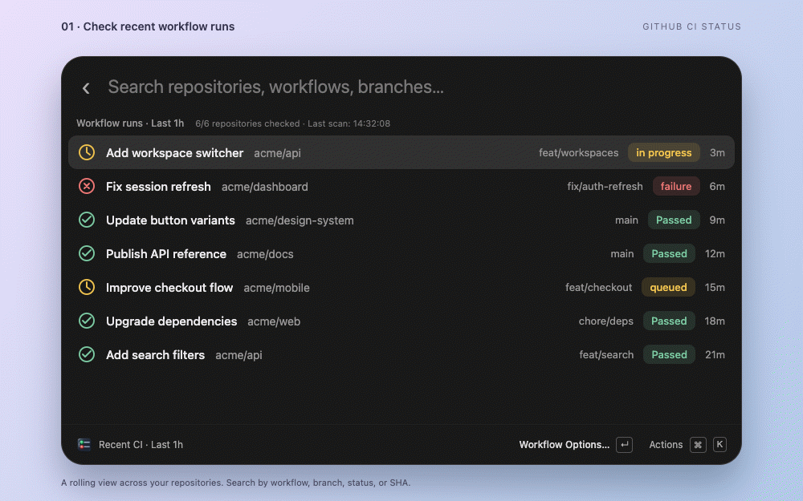
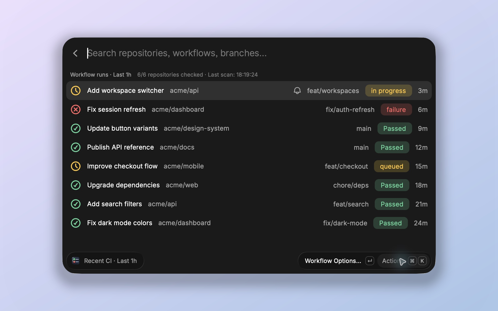
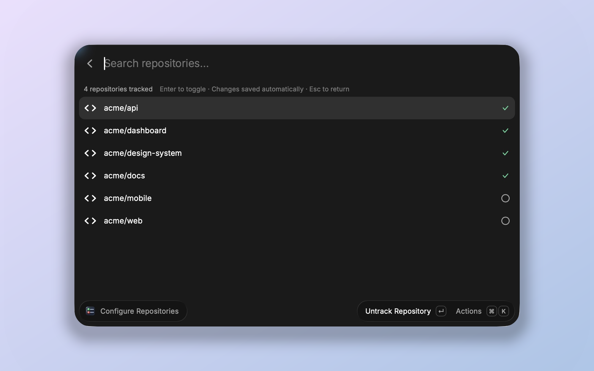

<div align="center">
  

# GitHub CI Status

**Your GitHub Actions, a keystroke away.**

Check recent runs across your repositories, follow the ones that matter,<br />
and get a clickable macOS notification when they finish. All from Raycast.


[](LICENSE)

[Get started](#get-started) · [Keyboard shortcuts](#keyboard-shortcuts) · [Notifications](#notifications) · [Development](#development)



<sub>12 states · Track a run → Get notified → Choose repositories → Handle scan states</sub>

</div>

## Keep CI within reach

| See what’s happening                                                                            | Follow what matters                                                                                         | Choose your scope                                                                              |
| ----------------------------------------------------------------------------------------------- | ----------------------------------------------------------------------------------------------------------- | ---------------------------------------------------------------------------------------------- |
| Recent GitHub Actions runs across accessible repositories, with clear status colors and search. | Track an individual run and receive a notification for each completed attempt, even after closing the list. | Watch every repository or pick a focused set. Search and update matching repositories in bulk. |

- **Sign in with GitHub.** No personal access token or custom OAuth app needed.
- **Open the right place.** Jump to a workflow run, repository, or associated pull request from the Actions menu.
- **Pick your window.** The rolling lookback defaults to `1h`; use durations such as `30m` or `2d` in preferences.
- **Keep your selections.** Repository choices and tracked runs are saved per GitHub account, including across token changes.

## Get started

Requires **macOS**, **Raycast**, and **Node.js 22.22.2+**.

```sh
npm install
npm run dev
```

1. Open **Recent CI** in Raycast and sign in with GitHub.
2. Browse your recent runs, or open **Configure Repositories** with **⌘⇧R** to choose repositories.
3. Select an unfinished run, press **Enter**, then choose **Track Notifications**.
4. Open **Watch CI Notifications** once and enable its **Background Refresh** in Raycast Settings → Extensions → GitHub CI Status.
5. Allow **terminal-notifier** in macOS System Settings → Notifications.

Private repositories require the OAuth `repo` scope. Organization policies may require approval for Raycast’s OAuth app.

## A closer look

### Recent CI

Search by repository, workflow, branch, status, or commit SHA. Passed runs are green, failures red, and queued or running runs yellow. Cancelled and skipped results have their own labels. A bell marks runs with notifications enabled.



The list refreshes every **30 seconds** while open. The time window uses each run’s **creation time**; older runs are excluded even if still running. Individually tracked runs stay accessible in a separate section after leaving the window and are checked directly by ID.

### Configure Repositories

All accessible repositories are included by default. Choose a specific set to focus scans, or search and track or untrack every matching repository at once. Changes save immediately.



Once you choose specific repositories, scans query only those repositories without full repository discovery. Untracking every repository pauses CI fetching. **Track All Repositories** restores automatic tracking of all accessible repositories. Repository search matches names without regard to case.

## Keyboard shortcuts

| Shortcut                              | Action                                                             |
| ------------------------------------- | ------------------------------------------------------------------ |
| **Enter**                             | Open Workflow Options for the selected run                         |
| **Enter**, then **Enter**             | Open the selected run on GitHub; Open in Browser is selected first |
| **Enter**, then **↓**, then **Enter** | Toggle notifications for an eligible run                           |
| **⌘K**                                | Open Actions                                                       |
| **⌘R**                                | Refresh results and repository discovery                           |
| **⌘⇧R**                               | Open Configure Repositories                                        |
| **Enter** in the repository picker    | Toggle the selected repository                                     |
| **⌘⇧T** in a filtered repository list | Track matching repositories                                        |
| **⌘⇧U** in a filtered repository list | Untrack matching repositories                                      |
| **Esc** in the repository picker      | Return to CI results                                               |

## Notifications

**Watch CI Notifications** checks individually tracked runs approximately **once a minute**, including when Recent CI is closed. Tracking a run also requests an immediate background check. Raycast must be running and Background Refresh must stay enabled; Raycast controls scheduling, so checks can be delayed on battery or while the computer sleeps.

Notifications include the final result, repository, workflow, branch, commit title, short SHA, and attempt number. **Click a notification to open the run on GitHub.** Success, failure, timeout, and cancellation are supported; other completed results, such as skipped, use a neutral icon.

The notification helper is bundled with the extension and runs natively on **Apple Silicon and Intel**. No Homebrew package or separate Raycast extension is needed.

<details>
<summary><strong>How run tracking works</strong></summary>

- Tracking is per run and separate from repository selection. It does not subscribe to future runs of a workflow.
- A tracked run stays tracked until you untrack it, including for later attempts of that same run.
- Each newly completed attempt sends one notification. Delivery errors keep the pending result for a later retry.
- Only unfinished runs can be newly tracked. Completed runs hide Track Notifications; previously tracked runs can still be untracked.
- Notifications describe the workflow result, rather than an individual failed job or log excerpt.
- Background checks never open a GitHub authorization dialog. If access expires or is revoked, sign in again through Recent CI.

</details>

<details>
<summary><strong>Missing a notification?</strong></summary>

1. Check that Watch CI Notifications has Background Refresh enabled and Raycast is running.
2. Allow notifications for **terminal-notifier**, the bundled helper, in macOS System Settings → Notifications. Permission for a different installation does not cover this copy.
3. Check macOS Focus and notification settings, which can suppress banners. The extension does not change them.
4. For development extensions, try Raycast’s **Run in Background** action and check **Extension Diagnostics** if scheduled execution does not run.
5. Check the monitor command’s subtitle for the last scan summary or an actionable error.

</details>

<details>
<summary><strong>Account storage, caching, and scan limits</strong></summary>

Repository choices and tracked runs are stored per GitHub account ID. Signing in to the same account preserves them when the token changes. Existing choices stored under the currently authenticated token migrate automatically; older token-based choices cannot be assigned to an account after that token is lost or revoked.

Repository discovery is cached for **15 minutes**. Scans use four concurrent workers, pagination, request timeouts, and rate-limit handling. Partial failures are displayed, and cached results are marked as potentially stale. GitHub limits filtered searches to **1,000 runs per repository**; the extension warns when that limit is reached.

The background monitor uses up to **four concurrent requests** with a **45-second request budget**. Interrupted scans save a continuation point so later watches are checked on subsequent launches. After resolving the signed-in account, an empty watch list makes no workflow requests. The monitor never requires full repository discovery, and GitHub retry deadlines are cached between launches and checked before another scan starts.

This extension covers **GitHub Actions**.

</details>

## Development

```sh
npm run check:notifier
npm test
npm run typecheck
npm run lint
npm run build
```

<details>
<summary><strong>Bundled notification helper</strong></summary>

The terminal-notifier **3.1.0** app, license, and source attribution live in [`assets/notification-helper`](assets/notification-helper). Development and builds automatically verify its pinned binary checksum, app signature, and both CPU architectures without downloading anything. The extension always uses its bundled copy.

To regenerate the helper from the official, checksum-verified release on macOS:

```sh
npm run setup:notifier
```

This is a maintainer command; extension users do not need to run it.

</details>

<details>
<summary><strong>Explore the walkthrough</strong></summary>

| Tracking and notifications                            | Repository selection                                | Scan states                                      |
| ----------------------------------------------------- | --------------------------------------------------- | ------------------------------------------------ |
| [Workflow Options](metadata/demo/options.png)         | [Repository picker](metadata/demo/repositories.png) | [Loading](metadata/demo/loading.png)             |
| [Tracked run](metadata/demo/tracked.png)              | [Filtered bulk actions](metadata/demo/filtered.png) | [No recent runs](metadata/demo/empty.png)        |
| [Completion notification](metadata/demo/complete.png) | [Fetching paused](metadata/demo/paused.png)         | [Partial scan failure](metadata/demo/issues.png) |
| [Older tracked runs](metadata/demo/older.png)         | [Overview](metadata/demo/overview.png)              | [Result types](metadata/demo/statuses.png)       |

</details>

---

Licensed under [MIT](LICENSE).
